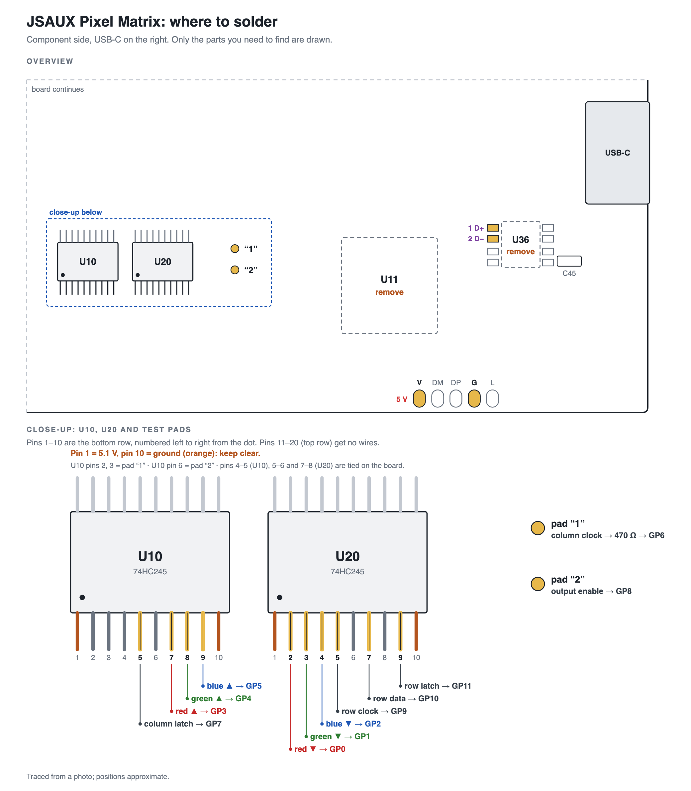
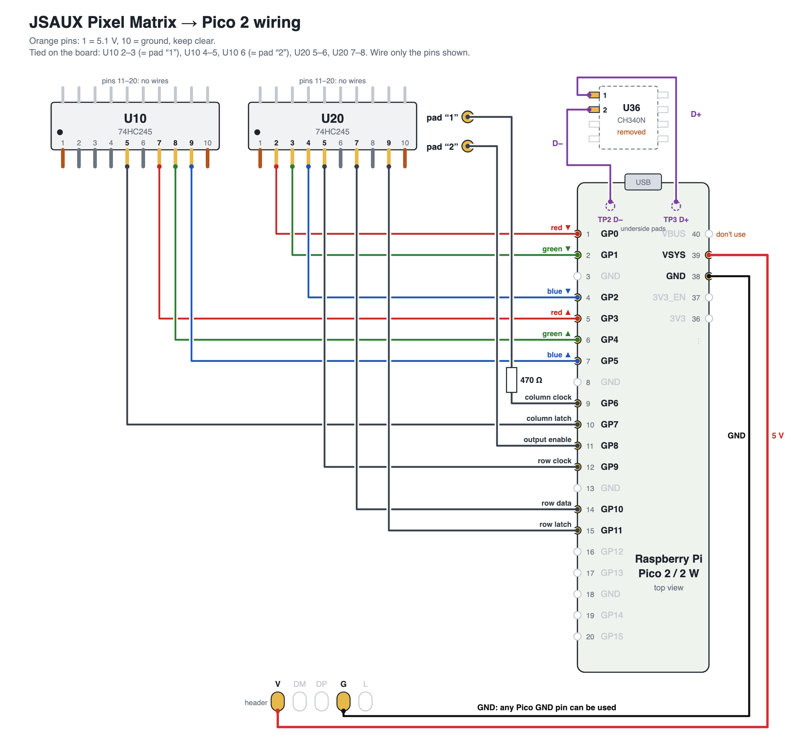

# JSAUX Pixel Matrix: replacing the controller

How to take the original microcontroller off the JSAUX Pixel Matrix faceplate (board marking
**DY LED-64X54-02**), wire a Raspberry Pi Pico 2 or Pico 2 W in its place, and drive the
64 × 54 RGB LED panel yourself.

This guide covers the board, the connections and the LED drive signals. It doesn't cover what
your computer sends to the new controller over USB: that's up to you.

Everything here was measured on one board with a meter and an 8-channel logic analyser in
November 2026, then confirmed by driving the panel from an RP2350. Treat it as one person's
measurements, and check with a meter before you solder.

## Contents

1. [What's on the board](#1-whats-on-the-board)
2. [The 12 LED signals](#2-the-12-led-signals)
3. [Why the Pico 2 (RP2350)](#3-why-the-pico-2-rp2350)
4. [Preparing the board](#4-preparing-the-board)
5. [Wiring a Pico 2 or Pico 2 W](#5-wiring-a-pico-2-or-pico-2-w)
6. [Driving the panel](#6-driving-the-panel)
7. [Power limits](#7-power-limits)
8. [Reference: the original controller's pins and timing](#8-reference-the-original-controllers-pins-and-timing)

---

## 1. What's on the board

### Parts

| Ref | Part | Package | Role |
|---|---|---|---|
| U11 | Unknown MCU, markings ablated | LQFP-48, 0.5 mm pitch | The original controller. **You remove this.** |
| X1 | 24 MHz crystal | — | U11's clock. Unused once U11 is gone |
| U10, U20 | 74HC245 | TSSOP-20, 0.65 mm pitch | One-way buffers between U11 and the LED drivers. **You wire to their inputs** |
| — | FM6124EJ × 24 | — | 16-channel constant-current column drivers, in 6 chains of 4 |
| U8, U21, U31 and others | TC6960 | SSOP-24, 0.65 mm pitch | 16-channel row driver shift registers |
| U22 | CIU25Q016B | SOIC-8 | 2 MB SPI flash. Held the original GIF and settings, no firmware. Unused once U11 is gone |
| U36 | WCH CH340N | SOIC-8 | USB-to-serial chip behind the USB-C port. **You remove this** so the Pico can use USB directly |
| C45 | Capacitor next to U36 | — | Decoupling for the CH340N. Can stay on or come off |

The original controller's firmware couldn't be read out or replaced: no serial bootloader,
SWD, USB boot or reset pin was found. Replacing the chip is the only way in.

### How the panel is organised

- 64 columns × 54 rows of RGB LEDs.
- Scanned as **two halves of 27 rows**, both lit at the same time.
  - **Top half:** rows 0–26. Its colours come through U10.
  - **Bottom half:** rows 27–53. Its colours come through U20.
- Each half has its own red, green and blue data line: **6 data lines** in all. Each one feeds a
  chain of 4 FM6124 column drivers (4 × 16 = 64 columns).
- All 6 chains share one column clock, one column latch and one output enable.
- Rows are selected by a chain of TC6960 row drivers with a shared row clock, row data and
  row latch.

### The 74HC245 buffers (U10, U20)

Every LED signal passes through U10 or U20, so the buffer **inputs** are where a new controller
connects. You never need to touch U11's tiny pads.

Pins 1–10 run down one side from the pin-1 dot; pins 11–20 come back up the other side.
Inputs are pins 2–9; the input on pin *n* comes out on pin 20 − *n*.

| Pin | Function | On this board |
|---|---|---|
| 1 | DIR | Tied to pin 20, so data flows A → B (inputs to outputs) only |
| 2–9 | A1–A8 inputs | Your controller's signals go here |
| 10 | GND | Ground |
| 11–18 | B8–B1 outputs | To the LED drivers. Leave alone |
| 19 | /OE | Grounded: always enabled |
| 20 | VCC | **5.1 V** (a separate rail, not 3.3 V) |

Because the buffers only pass data one way, the panel's 5 V logic never reaches your
controller's pins.

**Hazards:**
- **Pin 1 is 5.1 V** and sits next to input pin 2. A solder bridge puts 5 V onto your
  controller's GPIO.
- **Pin 10 is ground** and sits next to input pin 9.

### Inputs tied together on the board

Some signals arrive on two neighbouring buffer inputs that are joined by a trace. Wire to just
one of each pair. These pairs beep to each other with a meter; that's normal, not a bridge:
- U10 pins 2 and 3 (column clock)
- U10 pins 4 and 5 (column latch)
- U20 pins 5 and 6 (row clock)
- U20 pins 7 and 8 (row data)

### Pads you'll use

| Pad | What it is |
|---|---|
| **V** | 5 V from the USB-C port. Part of a 2.0 mm pitch header row (V, DM, DP, G, L) |
| **G** | Ground, on the same header row |
| **Test pad "1"** (near U10/U20) | Column clock input (same net as U10 pins 2 and 3). Easier to solder than the buffer leg |
| **Test pad "2"** (near U10/U20) | Column output enable input (same net as U10 pin 6) |
| **U36 leg 1 pad** | USB D+ from the USB-C port, once the CH340N is removed |
| **U36 leg 2 pad** | USB D− from the USB-C port, once the CH340N is removed |

The other header pads (DM, DP, L) belong to the old controller: DM and DP are U11's USB/flash
pins, and L is a factory-test strap. You don't need them. **The V pad is right next to DM:**
make sure your 5 V wire touches nothing else.

---

## 2. The 12 LED signals

These are all a controller needs. All are inputs of U10 or U20.

| # | Signal | Buffer input | Notes |
|---|---|---|---|
| 1 | Red, bottom half | U20 pin 2 | 1 = LED on |
| 2 | Green, bottom half | U20 pin 3 | |
| 3 | Blue, bottom half | U20 pin 4 | |
| 4 | Red, top half | U10 pin 7 | |
| 5 | Green, top half | U10 pin 8 | |
| 6 | Blue, top half | U10 pin 9 | |
| 7 | Column clock | Test pad "1" (or U10 pin 2 or 3) | Idles high. Drivers sample data on the rising edge |
| 8 | Column latch | U10 pin 5 (or 4) | Idles low. Short high pulse copies the shifted data to the outputs |
| 9 | Column output enable | Test pad "2" (or U10 pin 6) | **Low = LEDs on**, high = off |
| 10 | Row clock | U20 pin 5 (or 6) | Idles low. Short high pulse steps to the next row |
| 11 | Row data | U20 pin 7 (or 8) | High for the first row of each frame only |
| 12 | Row latch | U20 pin 9 | Idles low. High pulse around the row clock edge |

Plus a ground. If you can't reach a buffer leg, there are other tap points: column output
enable is on every column driver's pin 21, row clock on every row driver's pin 3, and row latch
on every row driver's pin 4.

---

## 3. Why the Pico 2 (RP2350)

- **Enough pins:** 12 outputs, and the 6 colour lines plus the column clock can sit on
  consecutive GPIOs.
- **PIO:** one PIO state machine shifts all 6 data chains in parallel, with the column clock as
  side-set, at 10 MHz and more. That's the same technique HUB75 panel drivers use. DMA feeds it,
  so the CPU barely works.
- **Two cores:** one core can scan the panel non-stop while the other handles USB and
  everything else, so USB traffic never makes the panel flicker.
- **Native USB device:** it connects straight to the USB-C port's data lines, so the CH340N
  isn't needed.
- **Update over USB:** firmware can reboot the RP2350 into its ROM bootloader (BOOTSEL)
  whenever it wants, so the board never needs opening again. The ROM bootloader can't be
  overwritten, so a bad firmware can always be replaced.
- **Enough RAM** (520 KB) to hold the bit-planes, several frames and an incoming file.
- **3.3 V logic drives the 5.1 V buffers fine** in practice, as described below.

**Pico 2 vs Pico 2 W:** both work, with the same GPIO numbers and the same physical pins. The
W's radio uses internal pins that don't clash with these. The plain Pico 2 is cheaper if you
don't need Wi-Fi.

**For a permanent fit**, a flat board with no parts underneath fits better inside the
faceplate. The final build here used a **SpotPear RP2350-Core-A** (RP2350, 2 MB flash, castellated
edges labelled with GPIO numbers) with the same pin assignments. A standard Pico 2 or 2 W is
easiest for a first build or a test bench.

**Logic levels:** a 74HC245 at 5.1 V officially wants about 3.6 V for a logic high, so 3.3 V
is below spec. But the original controller was itself 3.3 V and drove these same buffers, so
the design already relies on this margin. RP2350 outputs drove them with no errors at column
clocks up to 12 MHz. If you do see glitching, put a 74HCT245 or 74AHCT125 on 5 V between the Pico
and the buffer inputs.

---

## 4. Preparing the board

Nothing powered for any of this.

### 4.1 Remove U11 (the old controller)

- Use low-melt removal alloy (ChipQuik or similar) on all four sides of the LQFP-48, then lift it
  off. Clean the pads with wick and check for bridges.
- Removing it isn't optional. Left in place it would fight your controller on the buffer inputs,
  and if unpowered it would be back-powered through its protection diodes.
- If you really can't remove it, cut the traces from its legs 1, 7, 8, 9, 10, 27, 28, 29, 30, 31,
  47 and 48 close to the chip and leave its power connected. Removal is cleaner.

### 4.2 Remove U36 (the CH340N USB chip)

- Remove it the same way. C45 next to it can stay on or come off: it only decouples the CH340N's
  3.3 V supply.
- Afterwards, check with a meter through a USB-C breakout or a cut cable:
  - USB D+ beeps to the **U36 leg 1 pad**;
  - USB D− beeps to the **U36 leg 2 pad**.
- If you keep the CH340N instead, your controller must talk to it as a UART (U36 pin 6 is its
  TXD, pin 7 its RXD), and you lose the native USB benefits listed above. This guide assumes it's
  removed.

### 4.3 What stays

The buffers, all LED drivers, the USB-C port and its 5 V. Everything else near U11 can stay
too; see 4.4 for what can come off.

**Why keep the buffers (U10, U20)?** You could remove them and wire to their output pads instead,
but they do useful work:
- **Level shifting:** they run from 5.1 V, so the LED drivers get 5 V logic from your 3.3 V
  controller.
- **Drive strength:** the column clock, latch and output enable each go to all 24 column drivers.
  The buffers drive that load with clean edges, which a GPIO pin on its own might not.
- **Protection:** signals only pass one way, so nothing on the driver side can reach your
  controller's pins.

### 4.4 Optional: other parts that can come off

Only U11 and U36 have to go. These parts only served U11, U36 or the flash chip, so they do
nothing once those are gone. Removing them is optional: it frees space and tidies the board,
but every extra rework risks lifting a pad.

| Part | What it was for | How we know |
|---|---|---|
| U22 | 2 MB SPI flash: the old firmware's GIF and settings | Traced: only to U11 legs 22, 23, 24 (plus power) |
| R18 | 470 Ω between U11 leg 23 and U22 pin 2 | Traced |
| C26 | Next to U22; most likely its supply capacitor | From the board layout, not traced |
| X1 | 24 MHz crystal for U11 | Traced: only to U11 legs 14 and 15 |
| C39, C28 | Load capacitor pads for X1 (unfitted) | Traced |
| C27 | U11's core regulator capacitor (leg 11) | Traced: to leg 11 only |
| C13, C15 | Decoupling on U11's 3.3 V legs 2–4 | Traced |
| C45 | Decoupling on the CH340N's supply (legs 5 and 8) | Traced |

**Leave these alone.** We didn't trace them, but from their type and position:
- **R27, R28** next to the USB-C port: most likely the USB-C CC resistors. Without them, a USB-C
  charger or port may not supply 5 V at all.
- **U33** near the port: most likely ESD protection on the USB data lines. It now protects the
  Pico's USB.
- **U34** (3-pin regulator package) and the capacitors around it (C11, C12, C40, C41): most likely
  the 3.3 V regulator. It isn't known whether anything else uses 3.3 V.
- **R29, R30, R9, C14** and the two round pads by C14: purpose not known.

---

## 5. Wiring a Pico 2 or Pico 2 W

Where everything is on the board (component side, USB-C to the right):



### 5.1 Wire

- **Signals: 30 AWG Kynar** (solid, PVDF insulated) for the buffer legs. Each wire must sit on
  exactly one 0.65 mm-pitch leg.
- **USB D+ and D−:** 30 AWG is fine for the short run. Keep the two the same length, side by side
  or lightly twisted, and away from the column clock wire.
- **5 V and ground:** thicker wire if you have room. The panel draws amps at high brightness
  (section 7).

### 5.2 Connection list

One separate wire per line. Physical pin numbers are the Pico 2 / 2 W header pins.

| Board point | Signal | Pico GPIO | Pico pin |
|---|---|---|---|
| U20 pin 2 | Red, bottom half | GP0 | 1 |
| U20 pin 3 | Green, bottom half | GP1 | 2 |
| U20 pin 4 | Blue, bottom half | GP2 | 4 |
| U10 pin 7 | Red, top half | GP3 | 5 |
| U10 pin 8 | Green, top half | GP4 | 6 |
| U10 pin 9 | Blue, top half | GP5 | 7 |
| Test pad "1" | Column clock | 470 Ω in series → GP6 | 9 |
| U10 pin 5 | Column latch | GP7 | 10 |
| Test pad "2" | Column output enable | GP8 | 11 |
| U20 pin 5 | Row clock | GP9 | 12 |
| U20 pin 7 | Row data | GP10 | 14 |
| U20 pin 9 | Row latch | GP11 | 15 |
| G pad | Ground | GND (any GND pin) | 3, 8, 38… |
| V pad | 5 V supply | VSYS | 39 |
| U36 leg 1 pad | USB D+ | TP3 (underside test pad) | — |
| U36 leg 2 pad | USB D− | TP2 (underside test pad) | — |



Leave these unwired:
- U20 pins 1, 6, 8 and 10 to 20;
- U10 pins 1, 2, 3, 4, 6 and 10 to 20;
- the other Pico pins.

GP0–GP5 must stay in this order and GP6 must follow them: that's what lets one PIO program
drive all six chains with the clock as side-set. Other GPIO numbers work if your firmware uses
them, but keep the 6 data lines consecutive.

**The 470 Ω on the column clock** damps ringing on the long wire. Fit it at the Pico end.

### 5.3 USB

- The Pico 2 and 2 W bring the RP2350's USB data lines out to two test pads under the board:
  **TP2 = D−** and **TP3 = D+**. Before soldering, confirm with a meter that they beep to the
  micro-USB connector's D− and D+ pins. Then wire them to the U36 pads.
- **Never plug a cable into the Pico's micro-USB socket while it's wired to the panel.** That
  would put two hosts on the same data lines and connect two 5 V supplies together.
  Everything goes through the panel's USB-C port.
- Soldering to the underside pads makes the Pico thicker. If that's a problem inside the
  faceplate, use a flat board instead (section 3).

### 5.4 Power

- The panel's V pad (5 V from USB-C) goes to **VSYS (pin 39)**. The Pico's regulator makes its
  3.3 V from that. The Pico then powers on and off with the panel, so its pins never drive an
  unpowered panel.
- Don't use VBUS (pin 40) for this. VBUS connects straight to the micro-USB socket.
- **Test bench alternative:** power the Pico from its own micro-USB and leave VSYS, D+ and D−
  unwired. The panel's USB-C then only powers the panel. In that case your firmware must not
  drive the panel while it's unpowered. A 1:2 resistor divider from the V pad to an ADC pin
  (GP26) lets the firmware see whether the panel has power. Connect only ground, the 12
  signals and the divider.

### 5.5 Recommended extra

A **10 kΩ pull-up from test pad "2" (output enable) to the Pico's 3V3 (pin 36)** keeps the LEDs
off from power-up until your firmware takes the pins. Without it, the floating buffer inputs
can make the panel flash briefly at power-up. (Our build didn't have one and configured the pin as
the first thing at boot instead.)

### 5.6 Soldering order and checks

1. Tin each wire, then cut the tinned end back to about 1 mm, so it can only land on one leg.
2. Pads first: G, V, test pads "1" and "2", U36 legs 1 and 2.
3. U10 legs in the order 9, 8, 7, 5. Then check U10 before starting U20.
4. U20 legs in the order 9, 7, 5, 4, 3, 2. Pin 2 goes last because it's next to pin 1 (5.1 V).
5. Flux each leg, lay the wire straight along that leg, and touch the iron for about a second.
   Tape each wire down so the joint never takes any strain.
6. Before connecting the Pico, check with a meter (panel unpowered):
   - each wire's far end beeps to its own leg or pad;
   - no soldered leg beeps to the leg next to it, except the pairs tied together on the board
     (section 1). Check especially U20 pin 2 against pin 1, and pin 9 of both chips against
     pin 10;
   - no signal wire beeps to ground;
   - the V wire beeps to the V pad, and not to G or DM.

### 5.7 Alternative: SpotPear RP2350-Core-A (what our final build used)

It uses the same GPIOs as above. Its edge pads are labelled with **GPIO numbers**, not pin
numbers. Viewed from the top, with the RGB LED top-left and the BOOT button on the left:
- **top edge:** GND, U+, U−, 5V, 3V3
- **left edge, top to bottom:** 0, 1, 2, 3, 4, 5
- **bottom edge, left to right:** 6, 7, 8, 9, 10, 11, 12
- **right edge, top to bottom:** 29, 28, 27, 26, 15, 14, 13

Wire it exactly as the table in 5.2, by GPIO number: U20 pin 2 → **0**, U20 pin 3 → **1**, and
so on up to U20 pin 9 → **11**, with the 470 Ω between test pad "1" and **6**. Then:
- V pad → **5V**
- G pad → **GND**
- U36 leg 1 pad (D+) → **U+**
- U36 leg 2 pad (D−) → **U−**

No other pads are wired. Solder from the top so the underside stays flat.

### 5.8 First flash

Hold the Pico's BOOTSEL button while plugging the panel's USB-C into a computer. An `RP2350`
drive appears; copy your `.uf2` onto it. If your firmware can reboot into BOOTSEL by itself, for
example via `reset_usb_boot()` on a USB request, you never need the button again.

---

## 6. Driving the panel

### 6.1 Picture to signals

- A frame is 27 **rows**, both halves at once: row *r* shows panel row *r* (top half, through
  U10's colours) and panel row 27 + *r* (bottom half, through U20's colours).
- Each row is shown as **8 bit-planes** for 8 bits per colour. Plane *p* holds bit *p* of every
  LED's value, and is lit for a time proportional to 2^*p*.
- One plane = **64 column clocks**. On each clock, the 6 data lines carry one column's bit for
  red, green and blue of the bottom half and the top half.
- **Column order:** the first bit shifted ends up in the **rightmost** column (viewed from the
  front). So shift column 63 first and column 0 last.
- **Row order:** the row clocked in with row data high is the **top** row of each half. Every
  row clock after that steps one row down.
- Data polarity: **1 = LED on**.
- **Gamma:** apply gamma correction (2.2 works well) before splitting into bit-planes, or
  mid-tones look washed out. With 8-bit planes and gamma 2.2, the darkest ~8% of input values
  round to off. That's expected.

### 6.2 Column shift (per plane)

- Column clock idles **high**. Set the 6 data lines while the clock is high, pull it low, then
  release it high: the drivers sample on the **rising** edge.
- 64 clocks, then a column latch: a **high pulse** of about 100 ns (the original used 40–80 ns).
  The latch copies the shifted bits to the driver outputs.
- Clock rate: the original ran about 8.5 MHz. Our wiring was clean from 0.5 to 12 MHz; we run
  10 MHz. The FM6124's maximum wasn't checked against a datasheet.

### 6.3 Row change

With output enable **high** (LEDs off):

1. Wait ≥ 0.5 µs.
2. Set row data: high if this is the frame's first row, otherwise low.
3. Row latch high.
4. Wait 1 µs.
5. Row clock high.
6. Wait 80 ns, then row latch low.
7. Wait 100 ns, then row clock low and row data low.
8. Wait 0.5 µs.

This copies the original controller's sequence, which wraps the row clock's rising edge in the
row latch pulse. No initialisation of the row or column drivers is needed: just start scanning.

### 6.4 The scan loop

```
for each frame:
  for row r in 0..26:
    for plane p in 0..7:
      start shifting plane p of row r            (PIO + DMA, in the background)
      light the previous plane: OE low for its on-time, then OE high
      wait for the shift to finish
      if p == 0: row change (6.3)                (LEDs are off here)
      column latch
```

**Three rules prevent ghosting:**
1. Only latch column data while output enable is high (LEDs off).
2. Only change rows while output enable is high.
3. Shifting the next plane while the current one is lit is fine. That's what keeps the LEDs lit
   most of the time.

**On-times:** the original used 375 ns for bit 0, doubling each plane: 0.375, 0.75, 1.5, 3, 6,
12, 24 and 48 µs. Total about 96 µs per row.

- With the next plane shifted while the current one is lit, the LEDs are on about 80% of the
  time. Refresh was measured at 286 Hz with an 8.5 MHz column clock; at 10 MHz it works out at
  roughly 300 Hz (calculated, not measured).
- The original managed 54% and 228 Hz, because it left the LEDs off while shifting the last 3
  planes.
- Below about 50 Hz the panel flickers visibly.

**Brightness:** scale the on-times down, but **pad each plane with dark time so it still takes
its full-brightness length**. If you only shorten the on-times, the scan speeds up and repeats
frames faster, and the average current falls much less than the brightness setting suggests.

### 6.5 At power-up

- Drive output enable high (LEDs off) as early as possible, then set the other pins, then start
  scanning. Until your firmware runs, the buffer inputs float.
- Idle levels: column clock high; everything else low except output enable, which is high.
- Never drive the signal pins while the panel is unpowered (section 5.4).

---

## 7. Power limits

**Big bright-white pictures draw more current than a USB port supplies.**

What we saw from a Steam Machine USB port, with the scan above (LEDs lit about 80% of the time):
- With the white boot logo of our host software, the controller reset and dropped off USB.
- With a full white screen, the port switched itself off. The board stayed gone until replugged.
- Smaller or darker pictures were fine.

**What works:** a per-frame power limiter in the firmware.

1. For each frame, add up the gamma-corrected value of every LED (all 64 × 54 × 3), times the
   brightness setting. Full white at full brightness is 100%.
2. If the total is over the limit, scale every on-time down by the same factor, so the frame
   comes out exactly at the limit. Colours keep their balance; only heavy frames get dimmer.
3. Keep frame time constant (section 6.4), or the limit won't really limit.

**Measured on that Steam Machine port**, full white, 8 s per step:
- **20%, 30% and 40%:** fine, with no glitching.
- **50%:** the port cut out.

We settled on a **40% limit**. Other ports and chargers will differ: test yours.

The limiter treats red, green and blue LEDs as drawing the same current. That's only an
approximation, but it held on full white, the worst case.

---

## 8. Reference: the original controller's pins and timing

For anyone tracing the board further, or wanting to copy the original exactly.

### U11 legs (LQFP-48)

Numbered from the pin-1 dot, anticlockwise viewed from the top.

| Leg | Connects to | Role |
|---|---|---|
| 1 | U20 pin 3 | Green, bottom half |
| 2, 3, 4 | 3.3 V rail | Power |
| 7 | U20 pin 2 | Red, bottom half |
| 8 | U10 pin 9 | Blue, top half |
| 9 | U10 pin 8 | Green, top half |
| 10 | U10 pin 7 | Red, top half |
| 11 | C27 only | Probably the core regulator capacitor |
| 12, 13, 36 | G | Ground |
| 14, 15 | X1 | 24 MHz crystal |
| 22 | U22 pin 1 | Flash chip select |
| 23 | DM pad, U22 pin 5, U22 pin 2 via 470 Ω | Flash data |
| 24 | DP pad, U22 pin 6 | Flash clock |
| 25 | L pad | Factory-test strap (pulled up) |
| 27 | U20 pin 9 | Row latch |
| 28 | U20 pins 7, 8 | Row data |
| 29 | U20 pins 5, 6 | Row clock |
| 30 | U10 pin 6 | Column output enable |
| 31 | U10 pins 4, 5 | Column latch |
| 32 | U36 pin 6 | UART receive (from the CH340N) |
| 33 | U36 pin 7 | UART transmit (to the CH340N) |
| 35 | 3.3 V rail | Power |
| 47 | U10 pins 2, 3 | Column clock |
| 48 | U20 pin 4 | Blue, bottom half |

Legs 5, 6, 16–21, 26, 34 and 37–46 have no known function.

### The original scan, from logic analyser captures

| Quantity | Value |
|---|---|
| Rows per half | 27 |
| Row period | 162.6 µs |
| Frame period | 4.39 ms (228 Hz) |
| Bit-planes per row | 8, least significant first |
| Column clocks per plane | 64 |
| Column clock rate | ~8.5 MHz |
| Bit-0 on-time | 0.375 µs, doubling per plane up to 43.7 µs for bit 7 |
| LEDs lit | ~54% of the time |

**One row of the original, time 0 = row clock rising edge:**
- **−1.17 µs:** output enable goes high (LEDs off).
- **−0.96 µs:** row latch goes high.
- **0:** row clock rises.
- **+0.08 µs:** row latch falls.
- **+0.17 µs:** row clock falls.
- **+0.33 µs:** the plane 0 shift begins.
- **Planes 0–4:** the next plane's shift overlaps the current plane's on-time. Each plane is
  latched about 0.2–0.4 µs before its LEDs come on.
- **Planes 5–7:** shifted with the LEDs off.

**Start-up:** scanning begins about 160 ms after power-on. Nothing is sent to the drivers
beforehand, so no initialisation is needed.
